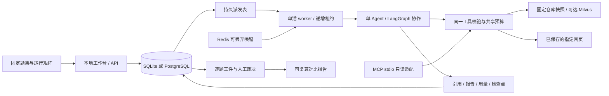

# 项目展示与技术追问

RepoLens的主线是“固定来源 → 受限工具调查 → 可核对引用 → 可恢复执行 → 可复算评测”。当前0.8.0只完成编译和静态检查，实际部署、模型质量及性能提升待验收。

## 可以展示的实现能力

| 能力 | 当前边界 |
|---|---|
| AST/全文检索与引用 | 固定Python仓库快照；hash/行范围检查不等于语义证明 |
| 协作调查 | planner/code/docs/reviewer、最多两轮补查、共享预算；模型评审不替代人工 |
| 混合检索 | 可配置Milvus/Embedding/Rerank，真实服务效果未验收 |
| 恢复 | 官方检查点、pending writes、累计预算与结果重放；未知外部请求可能重复费用 |
| 工程化 | 独立API/worker、数据库派发、Redis唤醒、PostgreSQL及Compose；保持单活worker |
| 网页资料 | 指定HTTPS允许站点，固定正文；可选断网浏览器侧车，失败标明静态降级 |
| MCP | 同一读取工具和scope的stdio服务，不执行任意外部命令 |
| V4评测 | 3个固定commit/30题草案、固定矩阵、人工裁决、报告；未运行真实实验 |

## 需要能讲清的取舍

1. 数据库保留权威状态，Redis只唤醒，所以丢通知可轮询补取；这不等同分布式多worker横向扩展。
2. 新worker的epoch阻止旧worker迟到写入；检查点、预算及响应缓存各自解决不同崩溃窗口。
3. 外部模型收到请求但响应未保存时，无法凭检查点保证exactly-once；保留未知预留并披露重复费用风险。
4. 代码与文档scope、已登记附件和快照hash共同限制资料来源；网页中的指令不能扩大工具权限。
5. 结构命中、模型评审、人工语义通过是不同证据；评测失败和未知不从分母消失。
6. 当前优先用全局短事务/单活worker保持一致性，长建库事务可能阻塞查询；优化并发需另做验收。

## 不能声称的成果

不能写“质量提升X%”“节省X%成本”“达到生产SLA”“真实任务成功率X%”。早期0.5.0的339项回归含脚本模型，不证明当前版本或真实效果。0.6.0之后按要求仅编译；本轮没有录制视频、运行评测或取得人工质量分。也未实现全网搜索、压缩消融、直接回答基线、认证公网部署或多活worker池。

部署入口见[infrastructure.md](infrastructure.md)，网页/MCP见[web-documents-mcp.md](web-documents-mcp.md)，正式评测流程见[evaluation.md](evaluation.md)，录像分镜见[demo.md](demo.md)。
